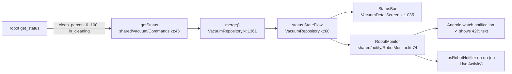

# Plan: cleaning progress percentage (iOS + Android)

## Status

The progress data already exists end-to-end; what is missing is only the in-app display.
The robot reports `clean_percent` (0..100) in `get_status`, it is parsed into
`VacuumStatus.cleanPercent` (shared/vacuum/VacuumStatus.kt:39), merged into the status
`StateFlow` (shared/vacuum/VacuumRepository.kt:1361), and already feeds Android's
background watch notification (shared/notify/RobotNotifier.android.kt). Neither in-app
surface renders it: `StatusBar` (ui/vacuum/VacuumDetailScreen.kt:1035) shows area/time
but ignores the percent, and the iOS notifier no-ops (RobotNotifier.ios.kt:31).

Both iOS and Android run the same Compose UI (`composeApp/src/commonMain`; the Swift app
is a thin `ComposeUIViewController` wrapper, iosMain/.../MainViewController.kt), so one
implementation covers both platforms.

## Phase 1 — Model: derive job progress (commonMain)

1. New `CleanProgress` value type in `shared/vacuum/` (new file `CleanProgress.kt`, next
   to `VacuumStatus.kt`): `percent: Int?` (clamped 0..100) plus a `phase` derived from
   `state` / `inCleaning` / `errorCode`, and helpers:
   - `jobActive` — `state in ACTIVE_CLEANING_STATES && inCleaning != 0`. `in_cleaning`
     stays non-zero through mid-job breaks (recharging, washing the mop) and goes to 0
     only when the job is over — the same boundary the notifications already use
     (RobotEvents.kt `jobOver`).
   - `percent` — `null` when `inCleaning == 0`; clamped monotonic within one run, since
     `clean_percent` can jump backwards between polls.
2. `VacuumStatus.toCleanProgress()` — pure function, no Compose, so it is unit-testable.
3. Tests in `composeApp/src/commonTest/.../shared/vacuum/CleanProgressTest.kt`
   (no compose UI test infra exists — there are no `androidUnitTest`/createComposeRule
   files — so plain logic tests only): monotonic clamp, break-then-end lifecycle, `null`
   for legacy robots that never report the field, and the `inCleaning` boundary.

## Phase 2 — UI: the bar (commonMain, one implementation for both platforms)

1. `CleaningProgressBar` composable in a new `ui/vacuum/CleanProgress.kt`: a thin
   `LinearProgressIndicator` with an animated `fraction = percent / 100f`, plus a caption
   row — `42%` when the robot reports it, else "In progress · 18 min" (elapsed time is
   already formatted in StatusBar).
2. Wire into `StatusBar` (VacuumDetailScreen.kt:1035): full-width bar under the headline
   while `jobActive`. `StatusBar` lives in `ControlBand`, which is shared by the phone and
   two-pane layouts (VacuumDetailScreen.kt:488 — "Status + controls live in one band so
   the phone and two-pane layouts cannot silently diverge"), so both get it for free.
3. Optional badge on `DeviceCard` (ui/devices/DeviceListScreen.kt:261) while a job runs —
   requires Phase 3; skip if Phase 3 is dropped.

## Phase 3 — Live progress in the app (design fork)

Today the monitor only drives *notifications*; in-app, its progress is not exposed to
Compose. To make the device list (and any screen) update live:

- `AppContainer`: add `cleanProgressByDuid: StateFlow<Map<String, CleanProgress>>`,
  updated in `onRobotProgress` (AppContainer.kt:172 — the existing `shownProgress` map
  dedups; extend it to also write the state flow).
- Consume in `DeviceCard` and `StatusBar`.

Costs:
- The monitor polls `get_status` every 10 s while a job runs
  (RobotMonitor.kt `activePollMs`), so the bar moves in ~10 s steps.
- It keeps one MQTT session per watched robot *always*, whereas today that only exists
  while background watch is enabled (AppContainer.kt:159). Enabling it for in-app use
  changes battery/MQTT load for everyone.

If that is unwanted, Phase 1+2 alone still deliver the feature: the robot **pushes**
status changes via dps (state transitions 5/6/10 etc. arrive instantly), so the bar is
live during actual cleaning — it just does not update during mid-job breaks
(charging/mop-wash, where `state` leaves `ACTIVE_CLEANING_STATES` but `inCleaning` stays
set and `clean_percent` is frozen).

## Phase 4 — Notifications (both platforms)

- Android: add `setProgress(percent)` to the standing watch notification
  (RobotNotifier.android.kt `watchNotification`) — one line; `RobotProgress.percent`
  already arrives via `showProgress`.
- iOS: implement `IosRobotNotifier.showProgress` as a Live Activity (ActivityKit +
  widget extension, app groups, the `liveActivity` capability in
  iosApp/iosApp.entitlements). This is the largest chunk of new work; the current no-op
  comment (RobotNotifier.ios.kt:29) explicitly deferred it.

## Scope options

| Scope | What you get | Effort |
|---|---|---|
| 1 + 2 | Live % bar on the detail screen, both platforms | ~1 day |
| 1 + 2 + 4a | + live % in the Android watch notification | +2 h |
| + 3 | Live % on the device list, ~10 s polling refresh | +half day |
| + 4b | iOS Live Activity | +2–3 days (extension, provisioning, TestFlight) |

## Open decisions

1. **Scope** — start with Phase 1+2 (recommended); decide on 3 and 4b separately.
2. **Bar shape** — thin linear bar under the status headline (default, reads well in the
   row) vs. circular ring around the status icon, official-app style. Both are cheap
   (Material3 `CircularProgressIndicator(progress = { fraction })` exists); pick one.
3. **Phase 3 tradeoff** — always-on per-robot monitor session for live list updates, or
   accept the push-driven behavior (live while cleaning, frozen in breaks).

## Verification

- `./gradlew :composeApp:allTests` (or the CI workflow's test task) for Phase 1.
- Android: `./gradlew :composeApp:installDebug`, run a clean, watch the bar in
  `VacuumDetailScreen`; confirm it animates on state push and freezes in breaks.
- iOS: Xcode build of `iosApp` (thin wrapper; no Swift changes expected), same checks.
- Notification change (4a): start a clean with the app backgrounded, confirm the watch
  notification shows and updates the percent.
